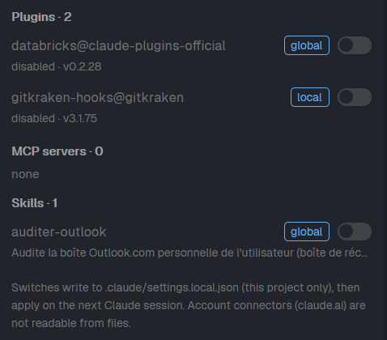

# Claude config

A side panel for Herdr that shows which Claude Code plugins, MCP servers and skills are available for the focused terminal's project, and whether each comes from the global config, the repo, or a local override. Each item has a switch to turn it on or off for that project. A button in the tab bar shows or hides the panel.

## What you see

- A 130px **Claude config** button at the right end of the tab bar (selected background while the panel is open).
- A panel on the right of the work area (380px, resizable 280 to 720), hidden at first. Header: "Claude config" and the project root.
- Three sections, each titled with a count: **Plugins**, **MCP servers**, **Skills**.
- Each row: name, a colored badge for its source (`global`, `repo`, `local`, or `plugin <name>` for things a plugin ships), a one-line detail (version and enabled state, server command or URL, skill description), and an on/off switch.
- A footer note: switches write to `.claude/settings.local.json`; claude.ai account connectors cannot be read from files.

## How it behaves

- The project is the git root of the focused terminal's folder (the folder itself outside git). It refreshes every 5 seconds and when focus moves.
- Plugins: the most specific settings file that mentions a plugin decides its state (`.claude/settings.local.json` over `.claude/settings.json` over `~/.claude/settings.json`). Plugins found only in `~/.claude/plugins/installed_plugins.json` show as disabled.
- MCP servers: `global` is `~/.claude.json` (`mcpServers`) and `~/.claude/settings.json`; `local` is a server set for this project in `~/.claude.json` (`projects`); `repo` is `.mcp.json` and `.claude/settings.json`. Servers shipped by enabled plugins are listed with a `plugin` badge.
- Skills: `global` is `~/.claude/skills/*/SKILL.md`, `repo` is `<root>/.claude/skills/*/SKILL.md`, plus skills inside enabled plugins.
- Switches write only to `<root>/.claude/settings.local.json` (created if missing, never overwritten if it changed meanwhile): plugins use `enabledPlugins`; `.mcp.json` servers use `disabledMcpjsonServers` / `enabledMcpjsonServers`; other MCP servers and skills use a `permissions.deny` rule (`mcp__<name>`, `Skill(<name>)`).
- An item turned off by another file (global or repo) shows "off (global)" instead of a switch; the mod never edits those files. Plugin-shipped skills and servers have no switch: turn off the plugin.
- Changes apply on the next Claude Code session.
- Local machine only: on a remote machine the panel says so.

## Built from

- `mods/claude-config/` with `main.js` and `mod.json` (`{ "place": "none", "title": "Claude config" }`). One mod, two roles: the default role draws the panel, `props: { "role": "toggle" }` draws the tab-bar button.
- Layout nodes (add to a layout you own; clone a shipped one first): wrap the `tabs` block in a row (keep its size) next to
  `{ "id": "claude-config-toggle", "type": "block", "content": { "mod": "claude-config", "props": { "role": "toggle" } }, "size": { "px": 130 } }`
  and add to the row that holds the panes
  `{ "id": "claude-config-panel", "type": "column", "hidden": true, "children": [{ "id": "claude-config", "type": "block", "content": { "mod": "claude-config" } }], "size": { "px": 380 }, "min": 280, "max": 720 }`.
- The button runs `layout.toggle {id: "claude-config-panel"}`.
- Herdr APIs: `spaces`, `panes`, `focused`, `exec`, `readTextFile`, `writeTextFile` (with the text read as the expected value), `home`, `theme`, `props`, `layout`, `run`; `fs/promises` `readdir`.
- Programs: `git rev-parse --show-toplevel`; PowerShell `New-Item` to create `.claude/` when missing (Windows).

## Watch out

- Backslash paths are normalized to `/` with `String.fromCharCode(92)`; regex literals with backslashes got mangled when the file was written by tooling, so avoid them.
- `writeTextFile` rejects on a stale snapshot, so the panel never overwrites a concurrent edit; the error shows in the panel.
- Skills have no official on/off switch in Claude Code: the `Skill(name)` deny rule is a workaround.
- It never writes `~/.claude.json`, which Claude Code rewrites itself.
- The panel reads files outside its folder (the Claude config files above) and runs `git` and PowerShell. It makes no network requests.

## Done when

- `herdr-app check ~/.config/herdr-app/mods/claude-config` passes and Herdr reports no errors.
- The button shows and hides the panel; the panel lists plugins, MCP servers and skills with the right source badges for a project with its own `.claude/skills`.
- Flipping a switch changes `.claude/settings.local.json` as described and the row updates within seconds; flipping it back removes the entry.
