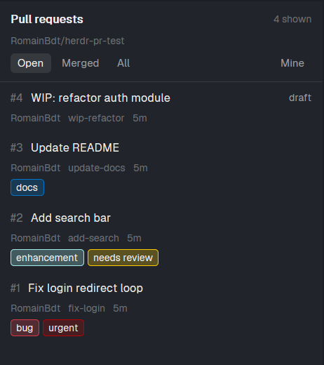

# Pull requests

A side panel for Herdr that lists the pull requests of the repository you are working in, with their GitHub labels as colored chips. Filter by Open, Merged or All, and switch on "Mine" to see only your own. Click a row to open the PR in the browser.

## What you see

- Header: "Pull requests", the repository (`owner/name`), and "N shown" (or "refreshing...").
- A filter row: **Open**, **Merged**, **All** on the left, **Mine** on the right (selected background when on).
- One row per PR (up to 50): `#number`, title (truncated), a status word on the right (`draft`, `merged`, `closed`), then a dim line with author, branch, age (`5m`, `3h`, `2d`) and the review decision when set (`approved` in the working color, `changes requested` in the blocked color).
- Under that, one chip per label, tinted with the label's own GitHub color.
- Empty and error states: "No open pull requests.", "No open pull requests by you.", or the first line of the `gh` error (for example "no git remotes found").

## How it behaves

- The repository is the one of the focused terminal's folder (its git remotes). Switching space or focus switches the list.
- Data comes from `gh pr list --state <open|merged|all> --limit 50 [--author @me] --json number,title,author,labels,isDraft,updatedAt,url,reviewDecision,headRefName,state`. Changing a filter reloads at once; otherwise it checks every 4 seconds but only calls GitHub again after 25 seconds for the same folder and filters.
- "Mine" combines with the state filter. It is not remembered across restarts.
- Clicking a row opens its URL with `cmd /c start`.
- Local machine only; on a remote machine the panel says so.

## Built from

- `mods/pull-requests/` with `main.js`, `mod.json` (`{ "place": "none", "title": "Pull requests" }`) and `pr.svg` (a 16px stroke icon drawn with `currentColor`).
- Two roles in one mod: the default role draws the panel, `props: { "role": "toggle" }` draws a 130px tab-bar button that runs `layout.toggle {id: "pull-requests-panel"}`.
- Simple integration (works with any layout you own; clone a shipped one first): wrap the `tabs` block in a row with
  `{ "id": "pull-requests-toggle", "type": "block", "content": { "mod": "pull-requests", "props": { "role": "toggle" } }, "size": { "px": 130 } }`
  and add to the row holding the panes
  `{ "id": "pull-requests-panel", "type": "column", "hidden": true, "children": [{ "id": "pull-requests", "type": "block", "content": { "mod": "pull-requests" } }], "size": { "px": 420 }, "min": 300, "max": 800 }`.
- Alternative: make `{ "id": "pull-requests", "type": "block", "content": { "mod": "pull-requests" } }` a child of the shared `panel-body` stack and add a button next to Files and Changes in a cloned copy of the `tabs` mod (its `panelButton("pull-requests", "Pull requests", "mods/pull-requests/pr.svg")`), selecting the stack child `pull-requests`.
- Herdr APIs: `spaces`, `panes`, `focused`, `exec`, `theme`, `props`, `layout`, `run`.
- Programs: the GitHub CLI `gh` (tried as `gh`, then `C:/Program Files/GitHub CLI/gh.exe`), logged in with `gh auth login`.

## Watch out

- `gh` must be installed and authenticated, and Herdr must see it on its PATH (restart Herdr after installing it).
- It makes network calls to GitHub through `gh` only; nothing else leaves the machine.
- Avoid regex literals with backslashes when generating the file with tooling; they can be mangled.
- Hidden copies keep their timer, so the panel still polls (throttled) while another panel is shown.

## Done when

- `herdr-app check ~/.config/herdr-app/mods/pull-requests` passes and Herdr reports no errors.
- In a repo with PRs, the list shows titles, authors, ages and label chips with the right colors; Merged and All change the list; Mine keeps only your PRs.
- In a folder without a GitHub remote the panel shows the `gh` error instead of a list.
